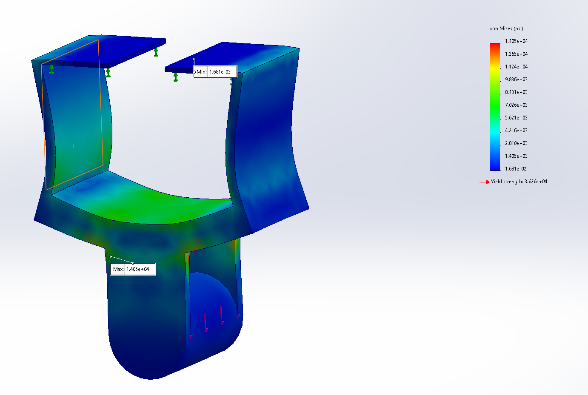
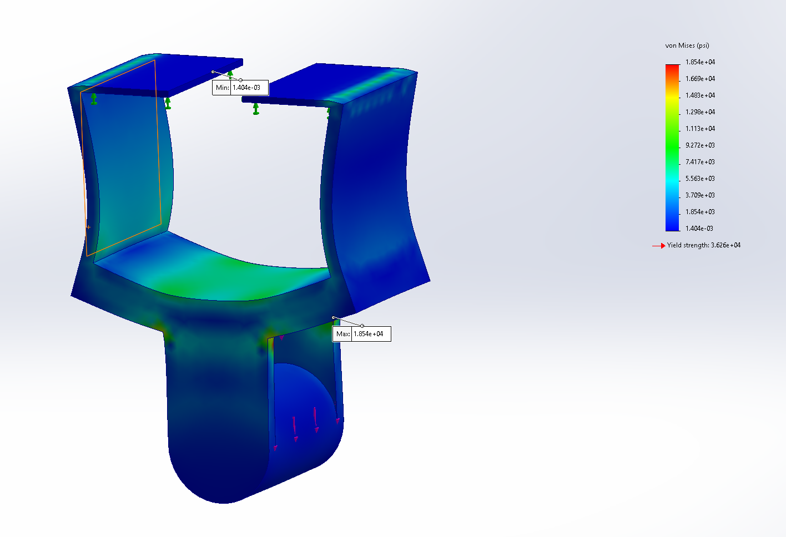
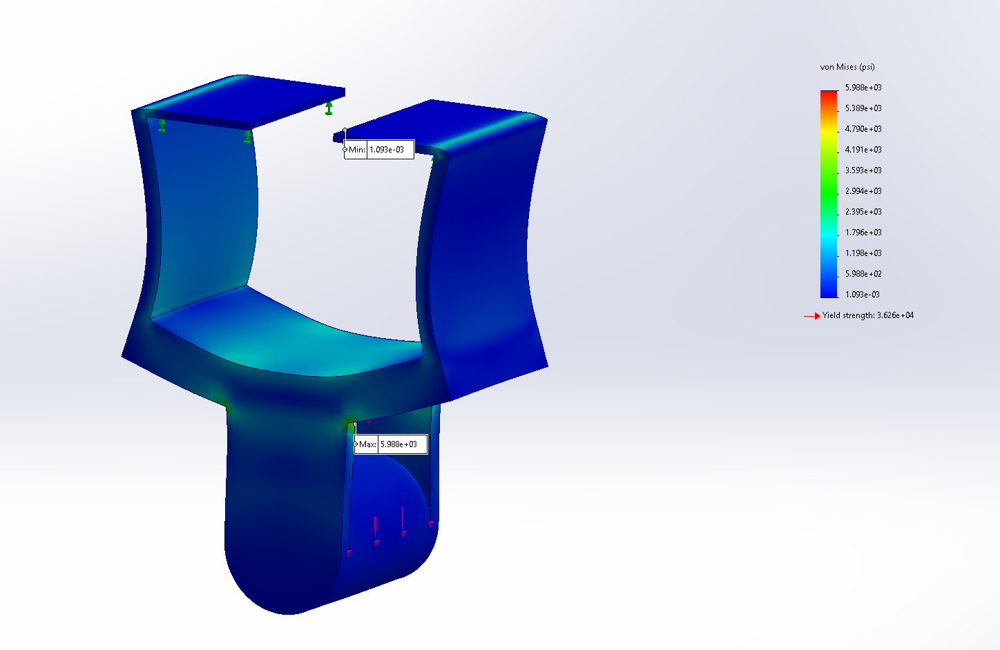
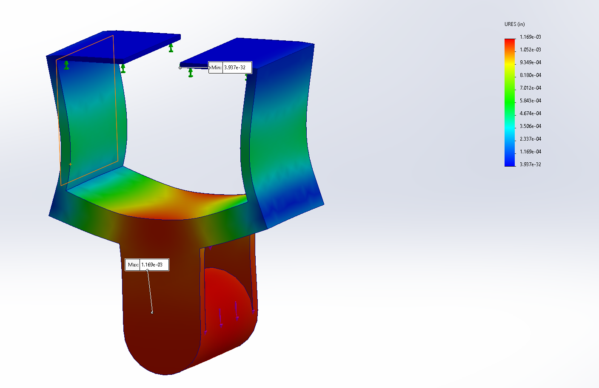
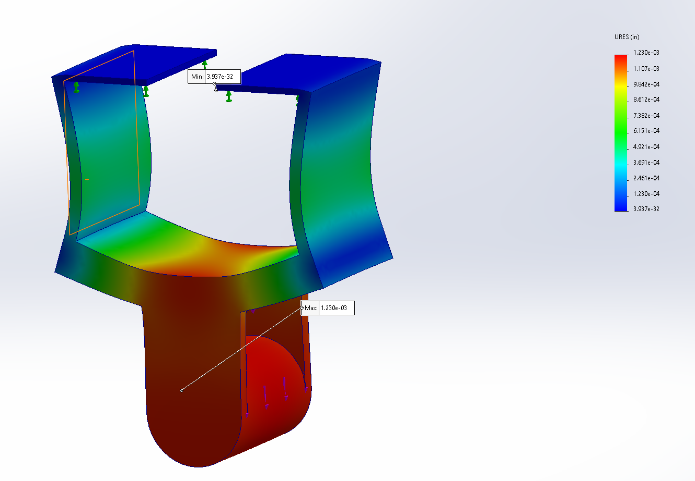
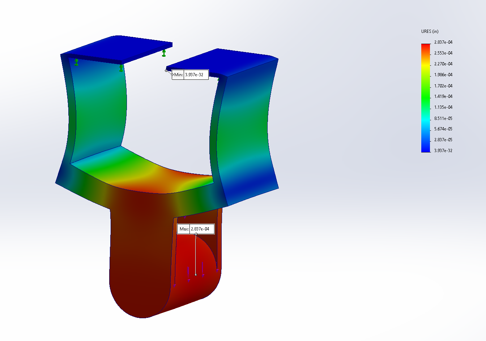

# A7 – [Topic]

## Objective

## Preparation

The first step before beginning this assignment was to assign the material I chose from the previous assignments to my bracket, which in this case was ASTM A36 Steel.  

Next, I applied the proper fixtures and load to the bracket.  I chose the underside of the upper-bracket as my fixed boundary because it would be the main point of contact when it was positioned correctly with the T-beam.  Then, I applied a downward load of 600 lbf on the bar holding the strap, which was also taken from the previous assignments.  The last step for preparing the bracket for analysis was to apply a mesh.  I chose to create the meshes ahead of time, for coarse and mid, and rerun the studies when I returned to make changes to the original model.  This was just a simple way to speed up the process, however my misunderstanding of the assignment instructions made this step a lot more complicated when I would return to it.

## Test 1

<table>
  <tr>
    <th></th>
    <th>Coarse</th>
    <th>Mid</th>
    <th>Fine</th>
  </tr>

  <!-- MAX STRESS -->
  <tr>
    <td><b>Max Stress and location</b></td>
    <td>
       
      1.537 x 10^5 psi 
    </td>
    <td>
       
      1.747 x 10^5 psi 
    </td>
    <td>
       
      4.749 x 10^4 psi 
    </td>
  </tr>

  <!-- MAX DEFLECTION -->
  <tr>
    <td><b>Max deflection and location</b></td>
    <td>
       
      9.244 x 10^-2 in 
    </td>
    <td>
       
      9.688 x 10^-2 in 
    </td>
    <td>
       
      2.249 x 10^-2 in 
    </td>
  </tr>

  <!-- MASS -->
  <tr>
    <td><b>Mass</b></td>
    <td>0.85 lbs</td>
    <td>0.85 lbs</td>
    <td>0.85 lbs</td>
  </tr>

  <!-- SAFETY FACTOR -->
  <tr>
    <td><b>Safety Factor</b></td>
    <td>2.36 x 10^-1</td>
    <td>2.075 x 10^-1</td>
    <td>7.635 x 10^-1</td>
  </tr>

  <!-- NUMBER OF ELEMENTS -->
  <tr>
    <td><b>Number of elements</b></td>
    <td>1746</td>
    <td>9944</td>
    <td>65166</td>
  </tr>
</table>

Applying the formula for convergence to stress, deflection, and FOS, only deflection sat below the limit of 7%.  This meant that I needed to create a third study for the fine mesh, which I would accomplish at a later point.  Returning to check for convergence a second time, my numbers for the fine mesh are a lot farther away, indicating an issue occurred somewhere along the way.  For now, after the three tests there remains to be any convergence.

## Test 2

Following the first study, I returned to the original model to make a design change that might improve the chance of convergence happening.  I decided to triple the already delicate thickness of the side walls of the bracket, increasing them to about 0.12 inches.  Afterwards, I reopened each of the studies and ran them a second time so that the changes were now incorporated into the FEA.  I then collected the numbers again and filled out the table below.

<table>
  <tr>
    <th></th>
    <th>Coarse</th>
    <th>Mid</th>
    <th>Fine</th>
  </tr>

  <!-- MAX STRESS -->
  <tr>
    <td><b>Max Stress and location</b></td>
    <td>
       
      1.533 x 10^5 psi 
    </td>
    <td>
       
      1.705 x 10^5 psi 
    </td>
    <td>
       
      4.817 x 10^4 psi 
    </td>
  </tr>

  <!-- MAX DEFLECTION -->
  <tr>
    <td><b>Max deflection and location</b></td>
    <td>
       
      9.215 x 10^-2 in 
    </td>
    <td>
       
      9.691 x 10^-2 in 
    </td>
    <td>
       
      2.247 x 10^-2 in 
    </td>
  </tr>

  <!-- MASS -->
  <tr>
    <td><b>Mass</b></td>
    <td>0.98 lbs</td>
    <td>0.98 lbs</td>
    <td>0.98 lbs</td>
  </tr>

  <!-- SAFETY FACTOR -->
  <tr>
    <td><b>Safety Factor</b></td>
    <td>2.365 x 10^-1</td>
    <td>2.127 x 10^-1</td>
    <td>7.528 x 10^-1</td>
  </tr>

  <!-- NUMBER OF ELEMENTS -->
  <tr>
    <td><b>Number of elements</b></td>
    <td>1716</td>
    <td>10178</td>
    <td>72109</td>
  </tr>
</table>

Running these numbers through the same convergence formula, the exact same instance occurred as with the first test, the deflection matched the criteria but nothing else did.  Because of this I again had to return to the fine mesh model and run the study again.  My numbers were again noticeably further away from the requirement, but I stopped here because it was my final attempt to reach convergence.  I would need to make more design changes before I could attempt convergence again.

## Test 3

The final modification I decided on was a stronger reinforcement of the bar holding the strap.  I believed that this would make a massive improvement for my design and increase the likelihood of reaching convergence in the next and final test.  This change came about from looking at the deformation of the bar in both of the previous tests, and would hopefully result in a sturdier bracket. 

<table>
  <tr>
    <th></th>
    <th>Coarse</th>
    <th>Mid</th>
    <th>Fine</th>
  </tr>

  <!-- MAX STRESS -->
  <tr>
    <td><b>Max Stress and location</b></td>
    <td>
       
      1.405 x 10^4 psi 
    </td>
    <td>
       
      1.854 x 10^4 psi 
    </td>
    <td>
       
      5.988 x 10^3 psi 
    </td>
  </tr>

  <!-- MAX DEFLECTION -->
  <tr>
    <td><b>Max deflection and location</b></td>
    <td>
       
      1.169 x 10^-3 in 
    </td>
    <td>
       
      1.23 x 10^-3 in 
    </td>
    <td>
       
      2.837 x 10^-4 in 
    </td>
  </tr>

  <!-- MASS -->
  <tr>
    <td><b>Mass</b></td>
    <td>1.00 lbs</td>
    <td>1.00 lbs</td>
    <td>1.00 lbs</td>
  </tr>

  <!-- SAFETY FACTOR -->
  <tr>
    <td><b>Safety Factor</b></td>
    <td>2.58</td>
    <td>1.955</td>
    <td>6.056</td>
  </tr>

  <!-- NUMBER OF ELEMENTS -->
  <tr>
    <td><b>Number of elements</b></td>
    <td>1798</td>
    <td>10323</td>
    <td>74765</td>
  </tr>
</table>

After the final test and measure for convergence, I found that my effort in the latest modification wasn't effective in the way I wanted it to be.  The values that I made note of in my chart were very different this time around, so my changes were impactful, but they didn't make a huge difference with the convergence calculations as their was still a large gap between my fine mesh and the coarse and mid meshes.  After all three tests, I was unable to get any semblance of convergence. 

## Reflection

Through this assignment, I learned how to execute an FEA in SolidWorks and adapt the design from the results of each test.  I learned the effect that the meshes have on the studies and why it is important that the process be kept to a strict cycle in order to avoid back tracking.  During this assignment, I improperly calculated for convergence and believed I had fit the criteria for all three tests and didn't run a study for fine mesh.  Upon my discovery, I had to undo the modifications I made and go back to my initial design from the previous weekly assignment.  It is very likely that this instance is what led to my meshes becoming so disconnected so far into my work.  The overall experience from the last few combined assignments with the same bracket have been very eye opening, seeing a number of different engineering processes be applied to a single part in the real world.  This took me between 3 and 4 hours.

## CAD

[A7 Model](A6_Bracket.SLDPRT)

