# A8 – Gears

## Objective

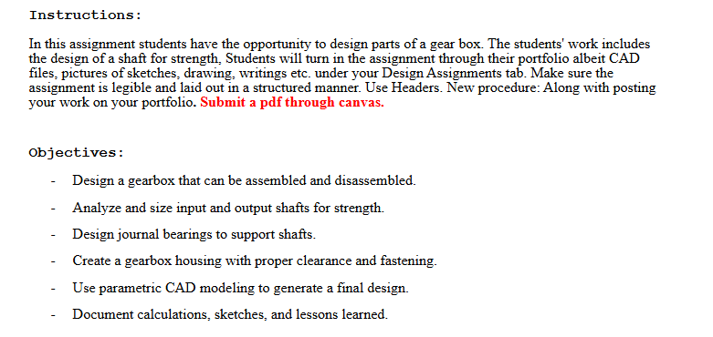

## Input and Output Shaft

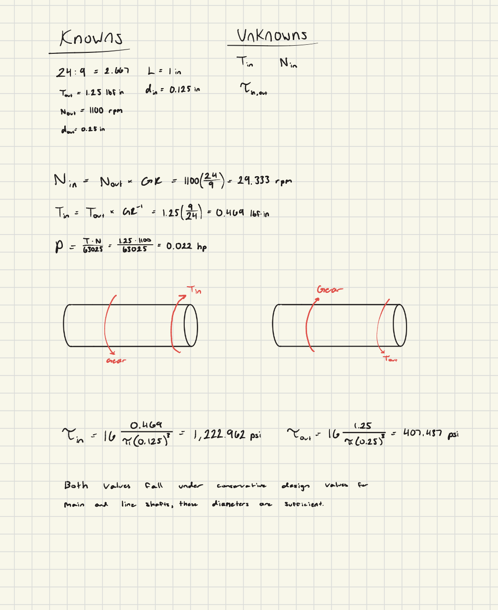

For this assignment, I combined my work for the input and output shaft into one page since their procedure was nearly identical.  The first thing I needed to do was display my known and unknown values for calculating stress on both of the shafts.  Having this information ready< alongside a visual representation of the shafts, I symbolically and then numerically solved for the stress of both shafts.  Comparing my calculated values to the 4000 psi and 6000 psi in the Machineries Handbook for main and line shafts respectively, my work fell well under these limits due to the size of the material.  I could proceed with these diameters.

## Journal Bearings

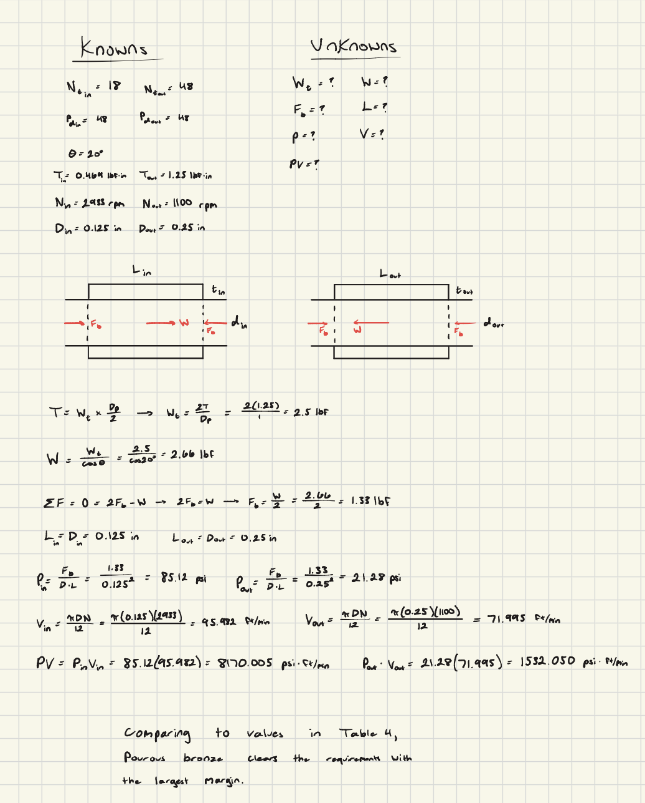

Using the values carried over from the first section, I again laid out my known and unknown values and drew FBDs that went for each of the shafts.  I used the same process as before to combine the work for both shafts and solve for pressure and velocity.  These values would be very important for determining what material would be selected.

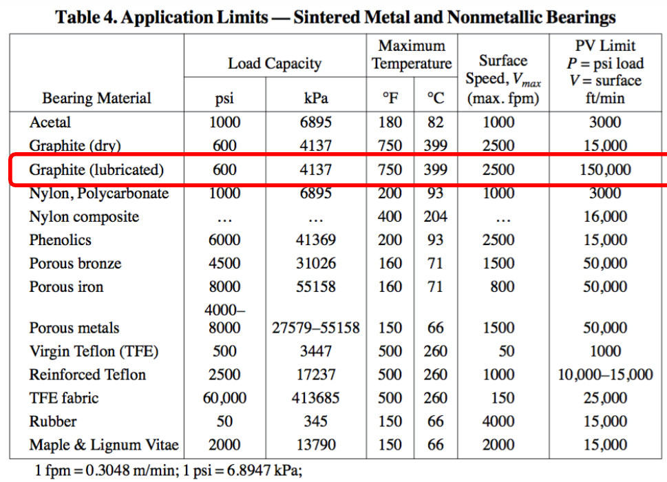

After looking at Table 4 from the lecture slides, I determined that porous bronze would be the most comfortable selection based off of my results thus far.   

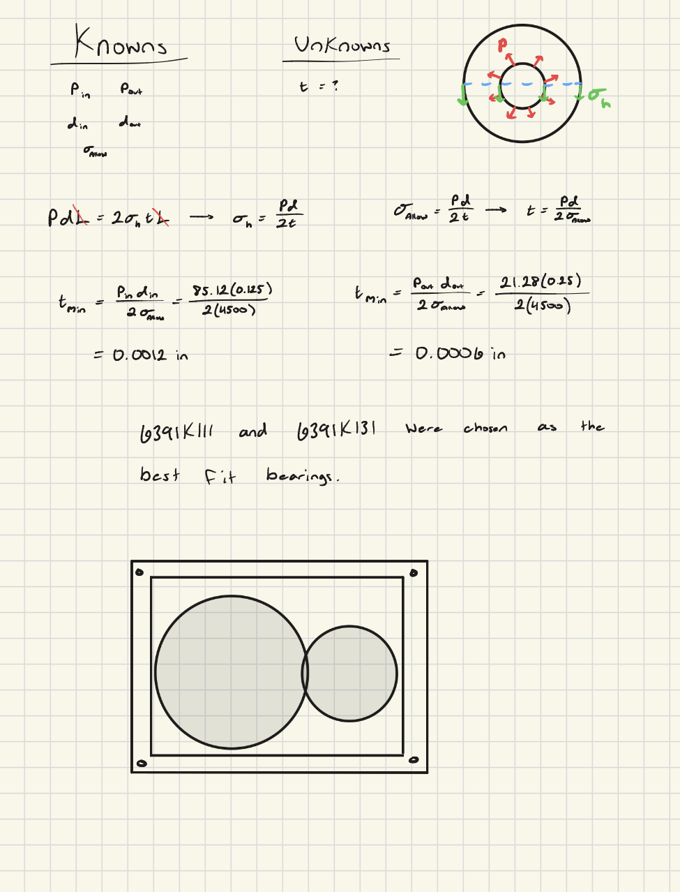

Before moving on to SolidWorks, I needed to calculate the minimum thickness of both shafts.  Alongside these calculations, I drew another FBD that showed the relationship between the stresses around the bearing.  After calculating these, I could compare the results to the journal bearings on McMaster-Carr to find the best selection for my calculations.  Finally, I drew another sketch that showed my idea for how my gearbox was gonna turn out.

## CAD Design

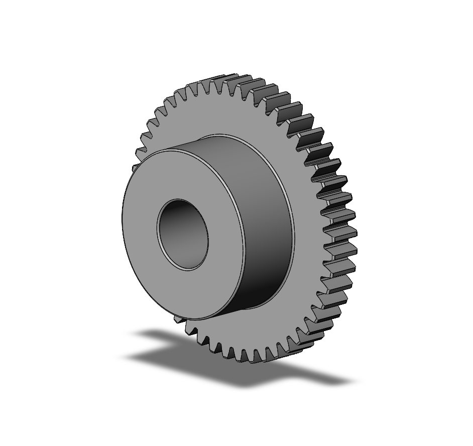

I downloaded the required gears as instructed on the assignment page.

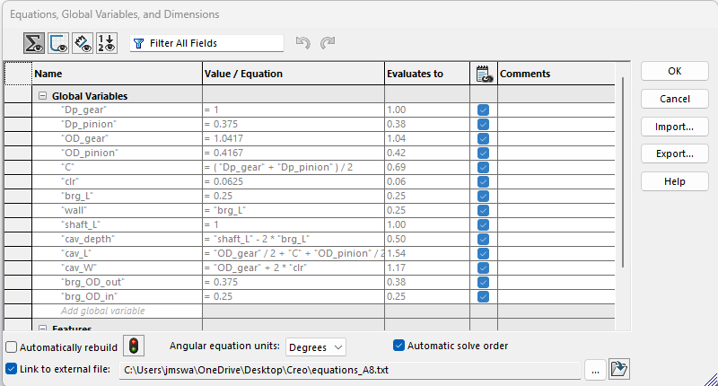

I inserted my equations into SolidWorks so that I could import it into all of my other upcoming CAD models.  This allowed me to save a lot of time and made it easier to line up these models when it the time came to assemble them.  

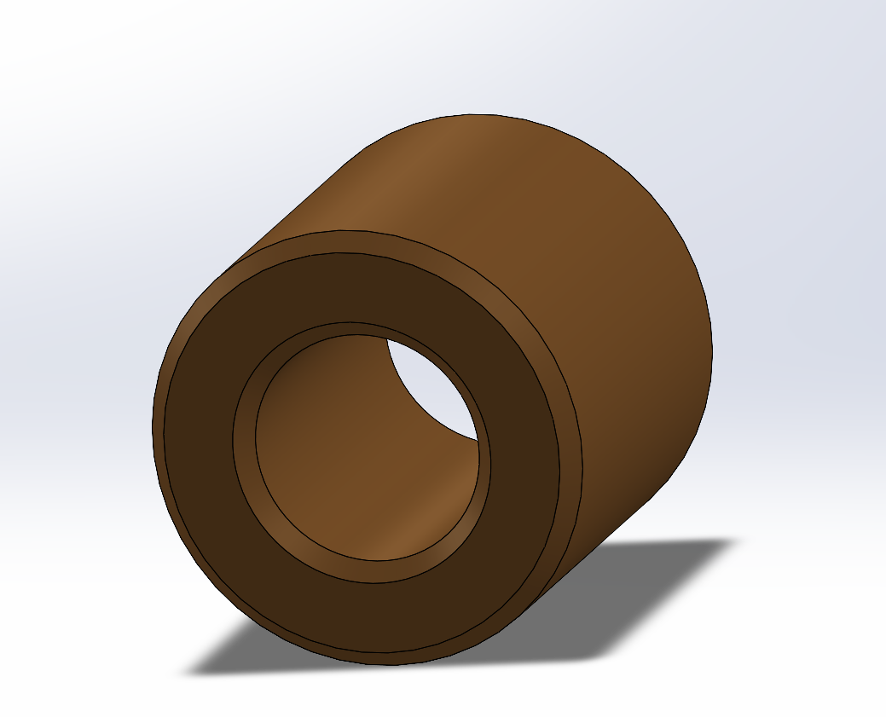

I ran into an issue with the journal bearings because I was getting an error that inhibited me from downloading the CAD models of the bearings I needed.  Because of this, I needed to pivot the assignment to make my own bearings, since I couldn't continue with the finished product until then.  Here is one of the two models that I recreated based on the McMaster-Carr models 6391K111 and 6391K131.

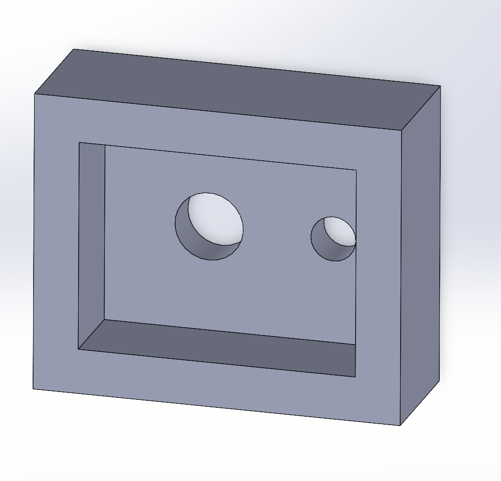

The final pieces I needed to prepare for the assembly were the gearbox and the lid.  Both pieces were mostly identical, the empty gearbox just had a thicker extrusion and a shell feature, while the lid was a flat surface that would be press-fit onto it.  These went by fairly quickly with the imported equations sheet.

## Assembly

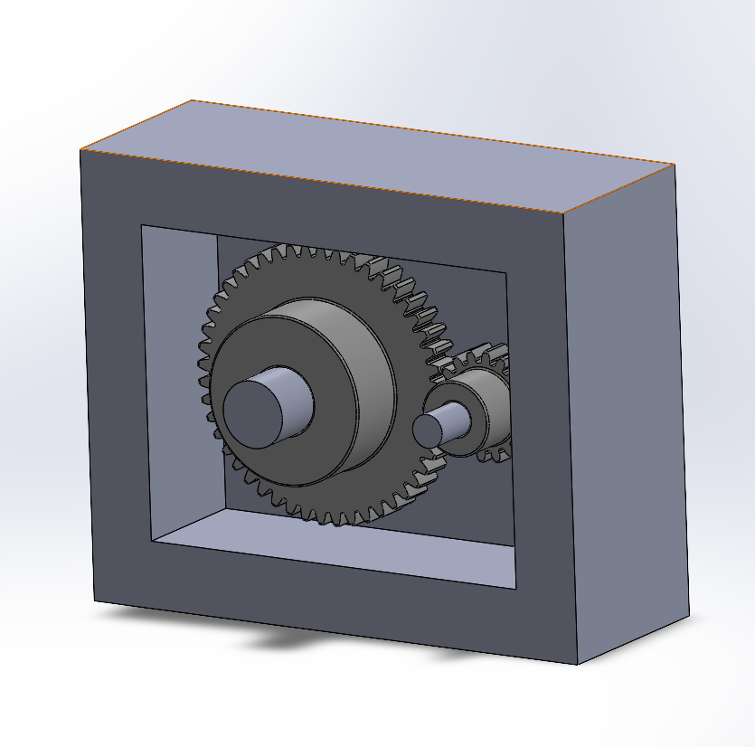

With the final parts modeled, I began to assemble them.  All of the parts that were mated were done so with a coincident, and this allowed the gears to fit together nicely.  I was initially worried the dimensions were gonna be off, but my references and equations pulled through.  This image shows the inside of the gearbox just before I assembled the lid onto it.

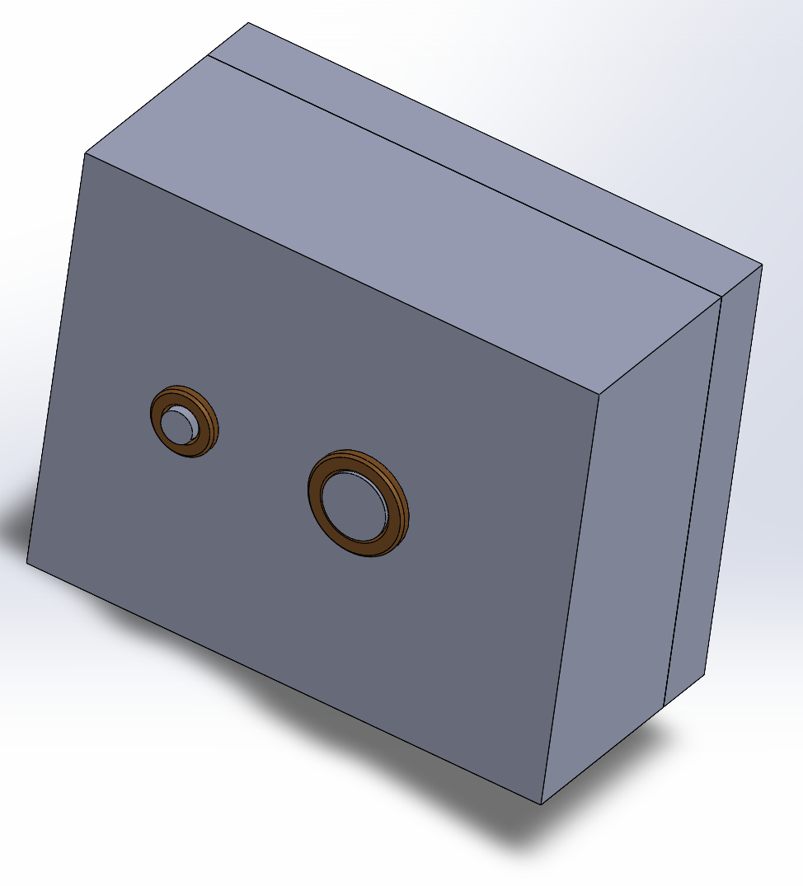

Here you can see the finished product.  The first thing that stood out to me was the length of the shafts inside of the gearbox.  Either they were too short, or the parts that I modeled around them were too big.  I am inclined to believe the latter because the shaft dimensions were all given to use at the beginning of the assignment.  Despite this small error, the rest of the gearbox turned out plenty well and I was very satisfied. 

[Completed Assembly](full_assembly_A8.SLDASM)

## Reflection

This biggest thing I learned through this assignment was that models are never guaranteed.  I wasn't sure what to do when the exact models I needed for the journal bearings weren't available to download, but I was fortunate in that all of the specifications were available in the listings, and I could easily recreate them.  This assignment also reminded me of the importance of having the right units set up in SolidWorks, which thankfully was caught before any real work had begone.  This assignment took me 5 hours.
