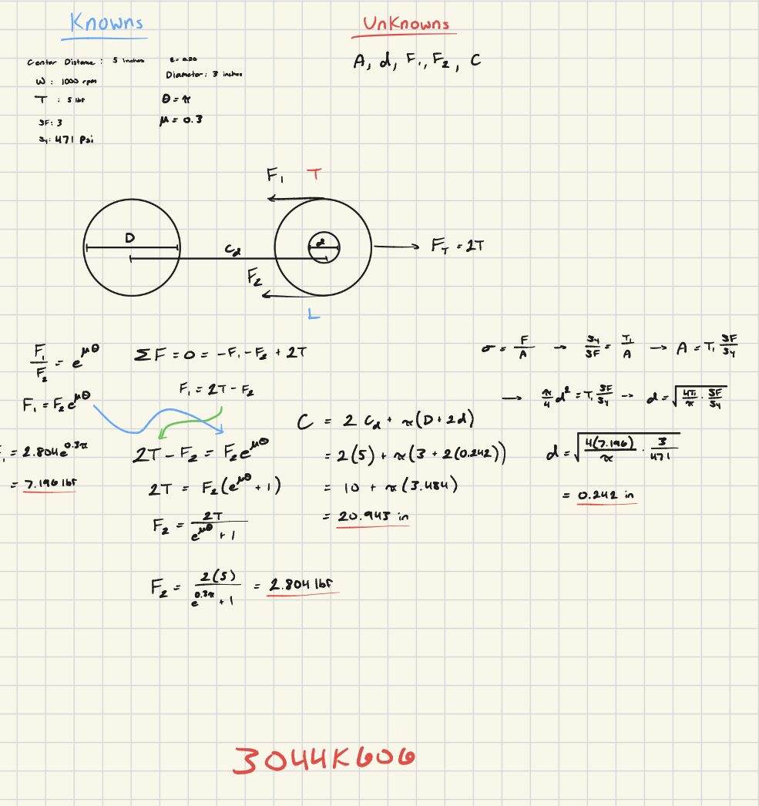
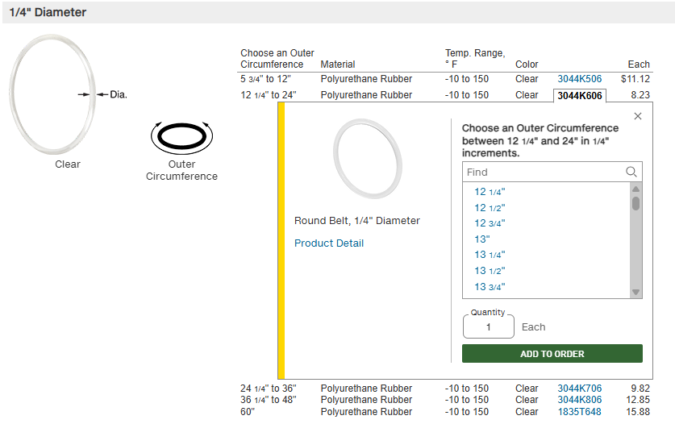
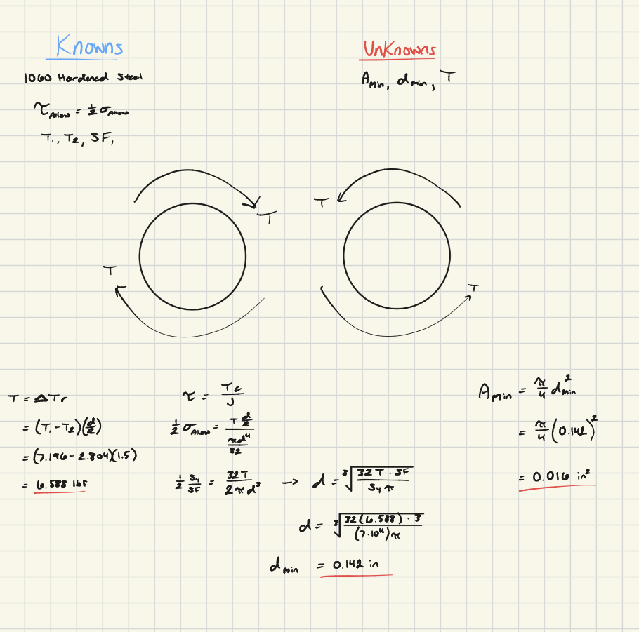
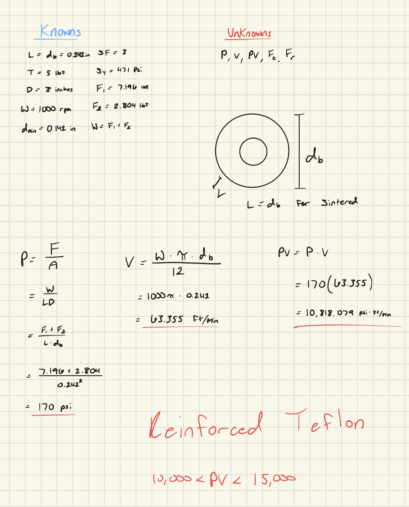
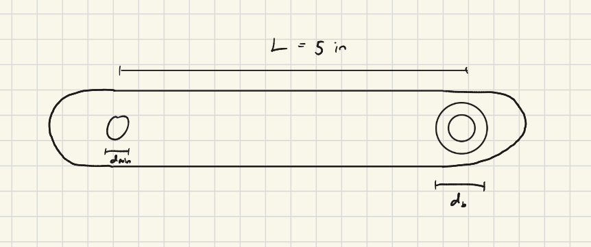

# A9 – Pulleys

## Objective

The objective of this weeks assignment was to design a pulley system to transfer power between two parallel axes using a mixture of given parameters and parameters of our choosing.  I chose a 5 in center distance, 1000 rpm rotational speed, 5 lbf belt tension, and ABS as the material.

## Belt Design

Above is the procedure for the belt design, including my known and unknown values, and my work for determining the cross-sectional area symbolically and numerically.  I also included a FBD to better understand the relationship between both of the tensions.  Once I had this information, I was able to look at McMaster to find the most suitable belt for my calculations.

With the given information that the belt is made from polyurethane rubber, and my diameter of just under a quarter of an inch, I was able to select 3044K606 as the most suitable belt for my design.

## Shaft Design

Next, I calculated diameter again for the shaft design.  The route to finding the diameter was different than for the belt design because this diameter had to take shear forces from the belt tension into consideration.  Otherwise, the procedure was the same and another FBD was included for the shaft.

## Journal Bearing

Finally, I applied the same procedure to the journal bearing design using sintered metal to determine pressure, linear velocity, and the PV rating, and use it to find a suitable material.  I used googled to learn more about what sintered metal meant for my design and how it would be incorporated into my calculations, and found that the length and diameter were the same in most cases.  So I set the length of the bearing equal to the diameter I had calculated for when I calculated pressure.  Using the PV rating I got, I looked at table 4 on page 2442 of my 32nd edition _Machinery's Handbook_ and found that the best fit material was reinforced teflon.

## Engineering Analysis

For the final part of the assignment, above is a simple design I made for the pulley frame made using a select few of the dimensions I had calculated or had chosen at the beginning of the assignment.  I modeled it heavily after the example model in the appendix with a few minor additions to show where my work for this assignment would be seen.

## Reflection

During this assignment, I learned how to evaluate for pressure in a pulley system using the tight and loose tensions.  I also learned how my chosen parameters impacted the different diameters associated with the system and how this impacted the selection of bearing material and belt selection.  This assignment took 3 hours to complete.
