# A10 – Lead Screw Translating System

## Objective
This assignment was a team assignment that consisted of Carlos Aranda Perez, Gavin Winningham, and Jason Swanchara. For this assignment, we were tasked with designing and building a mechanically driven tensile tester capable of applying a 2 kN axial tensile load with a controllable crosshead speed from 1 to 50 mm/min. The system had to provide consistent, well-aligned loading for polymers and light metals, suitable for instructional use and basic materials evaluation. The leadscrews needed a minimum height of 18 inches, and a safety factor of 4 was used.

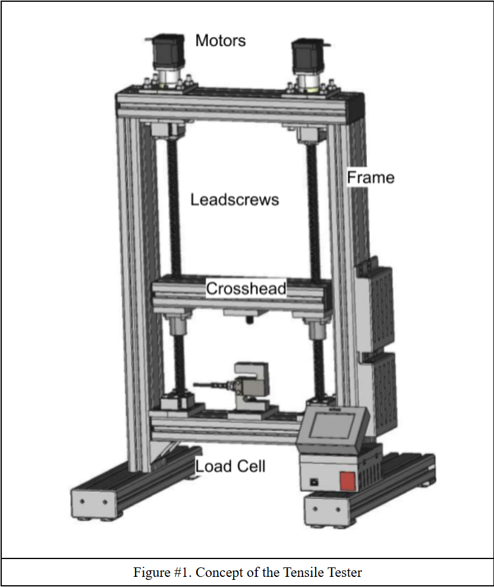

## Analyze

### **Part One: Leadscrew Diameter - Carlos Aranda Perez**

For this part of the assignment, I was tasked to find the diameter of the lead screw, range and rotational speed, and max torque. 

**Minimum Diameter**
The first part I did was find the diameter, using the axial stress. First, I started by listing all the knowns and unknowns.

I treated the screw as a solid cylindrical shaft. The base is not the actual base and is just a placeholder for the bottom part of the base. For this particular problem, I had trouble figuring out exactly what force to use. We are reminded to consider that there are 2 screws that would be used. Given these factors, I assumed that this meant we would have to split the forces. For this part I went with my intuition and continued with the assignment.
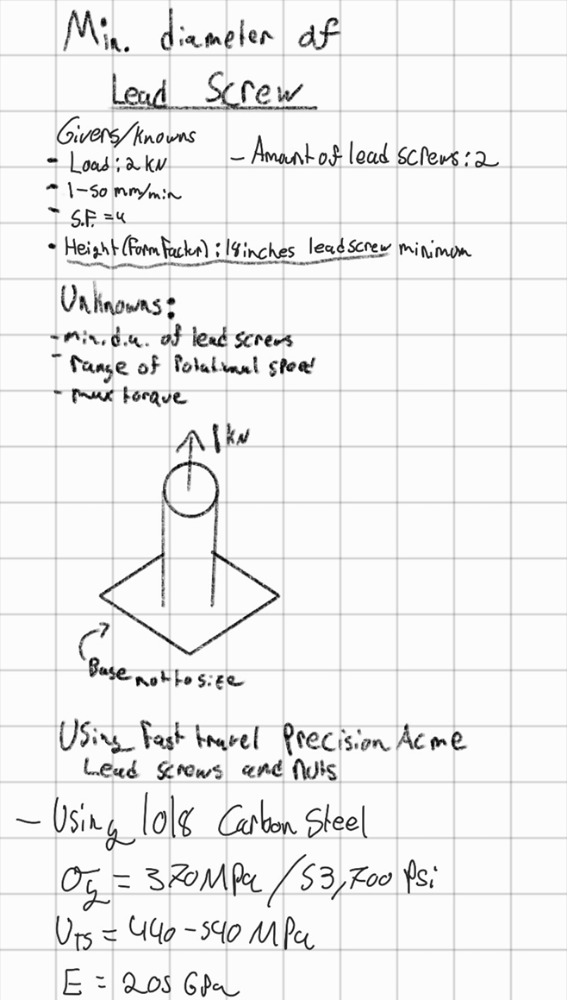

Once I had my free body diagram laid out, solving for the diameter was pretty straightforward. I had to use my cross-sectional properties to find the area, and I also had to take into account the allowable stress. One part I had trouble with was figuring out what kind of material to use for my bolt. I looked up common materials for lead screws and compared it to the list McMaster had and decided it should be made with 1018 carbon steel.

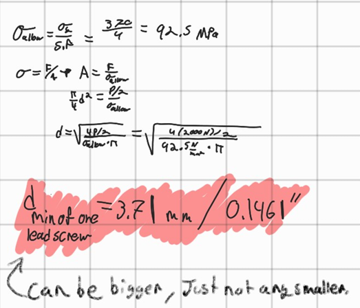

**Range of Rotational Speed**

After finding the diameter, I had to determine the range of rotational speed. The first thing I did was list my knowns and unknowns. I drew the free body diagram to figure out what I was looking for. 

After doing that, I used the formulas from the lecture to find the rotational speed. One problem that I did have trouble figuring out was what the linear velocity was. Since I had already calculated a relative value for the diameter, I went ahead and picked a bolt size. I decided to go with a ⅜-12 bolt; on McMaster-Carr, it said that the linear speed was 0.083 inches, or 2.108 mm.

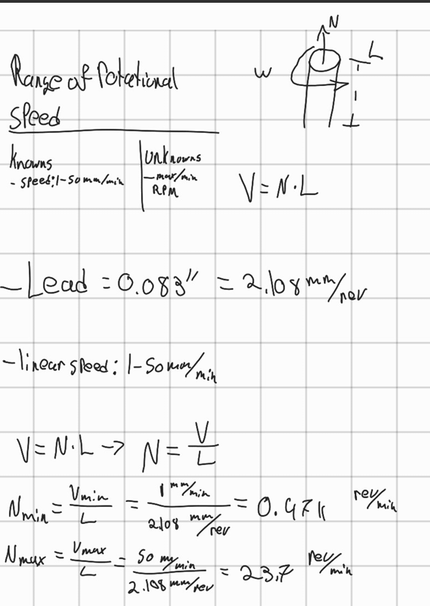

After that, I decided the parameters for the Max Torque and, since I was a bit lost, I searched online and I ended up with an equation that had more parameters. This led me to assume friction, collar friction, and its diameter. 

**Max Torque**
Finally I was able to plug in for all the values needed for torque.

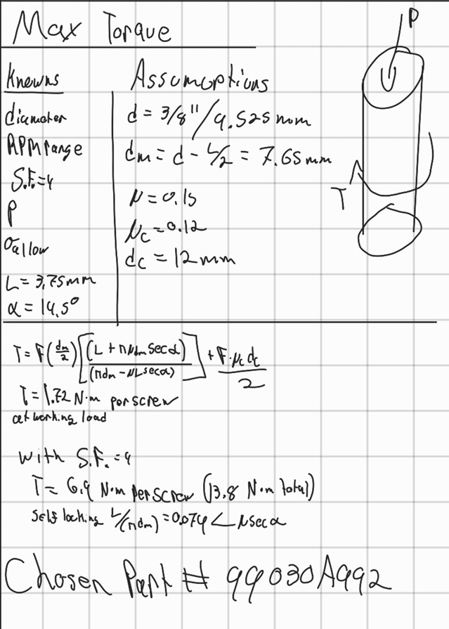

### Part 2: Nut and Flange - Jason Swanchara
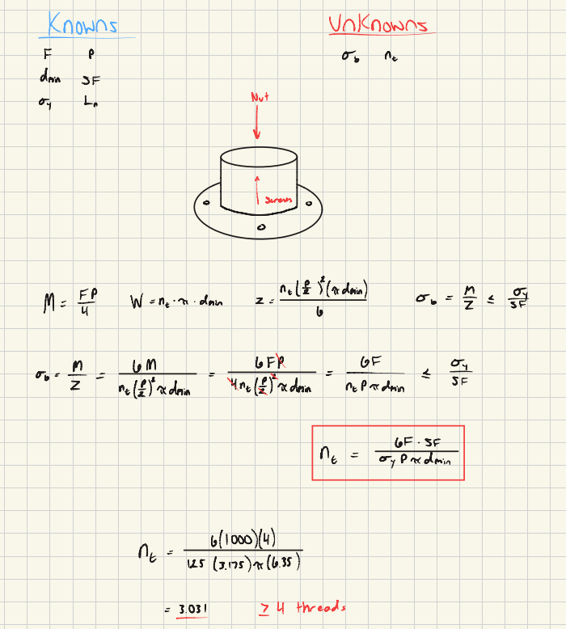
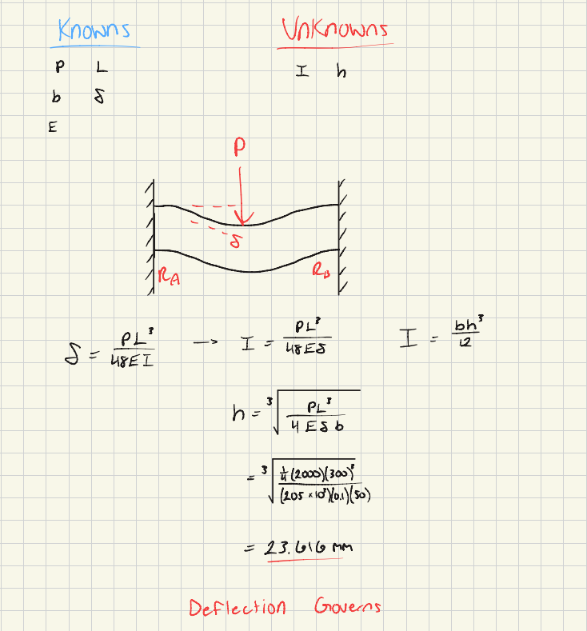

Above is the work for the thread count attained with the bending stress analysis equations from the lecture slides.  Alongside the work is a FBD that was included to help visualize the acting forces that contributed to the symbolic solutions.  Using the values calculated above, a right hand bronze acme nut was chosen from McMaster that is externally threaded and satisfies our given constraints and compatibility requirements.  Due to it being externally threaded, it requires a compatible flange to be used as well.

### Part 3: Crosshead Design - Jason Swanchara

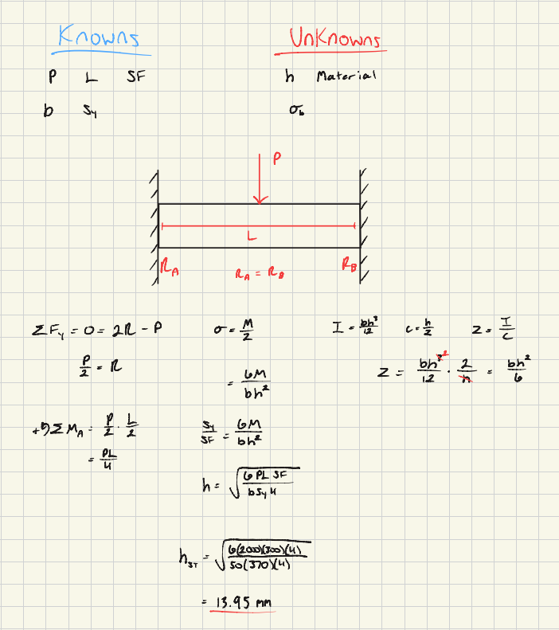

In order to design the crosshead, I treated it as a beam fixed on both ends with a center load P in the middle.  The load and combined reaction forces were used to solve for the height in through stress and deflection, and afterwards it was determined that deflection governed this parameter because it was the larger of the two.  A 1018 steel bar was chosen for the material because of its reliability and to combat the stronger deflection.

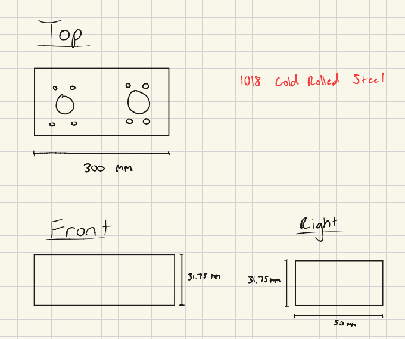

Above is the final geometry for our crosshead.  Our final height came out to 31.75 mm with a base that was a little over the minimum constraint given in the assignment.  The crosshead was drawn out with the intention of being quick and easy to model in SolidWorks, but still effective in operation and being stiff enough to limit deflection.

### Part 4: Cost Tabulation - Gavin Winningham

| Item Number | Quantity | Name | Cost per Item | Cost | Purchase Link |
|---|---:|---|---:|---:|---|
| 47065T102 | 4 | T-Slotted Frame | $18.76 | $75.04 | [Purchase Here](https://www.mcmaster.com/47065T102/) |
| 95120A592 | 2 | Flange Nut | $111.78 | $223.56 | [Purchase Here](https://www.mcmaster.com/95120A592/) |
| 99030A992 | 2 | Lead Screw | $17.04 | $34.08 | [Purchase Here](https://www.mcmaster.com/99030A992/) |
| **Total** | **8** | | | **$332.68** | |

### Part 5: Parametric Modeling - Gavin Winningham
I first started the 3D modeling process by creating the crosshead. I started off by accounting for the lead screw diameter to ensure it would pass through the designed crosshead efficiently. I next then created bolt holes to go into the flange nut that would secure it properly as this item is to be screwed up and downwards. As depicted below, my dimensions utilized for both the hole for the lead screw as well as the bolt pattern for the flange.

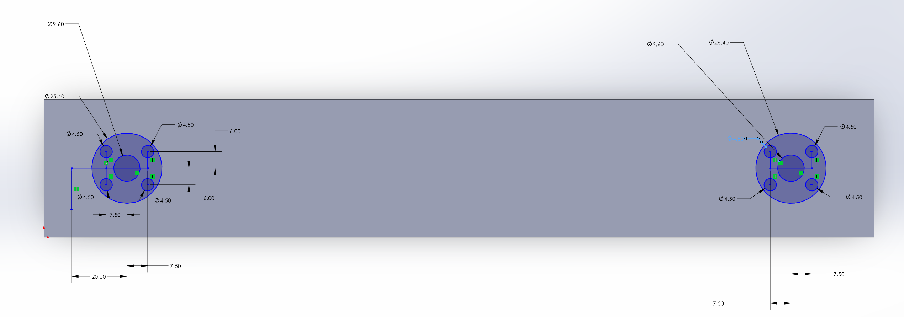

I next started with the actual assembly of the entire project. I started off initially taking the crosshead and the lead screws and mating them to one another, ensuring they pass through efficiently, as well as mating the tops of the lead screws to one another so that they are aligned. After doing so, I then started to add the frame onto the edges of this project, starting with two foot-and-a-half-long T-rail frames, exactly the same length as the lead screws, as depicted below; this is the continuation of that assembly.

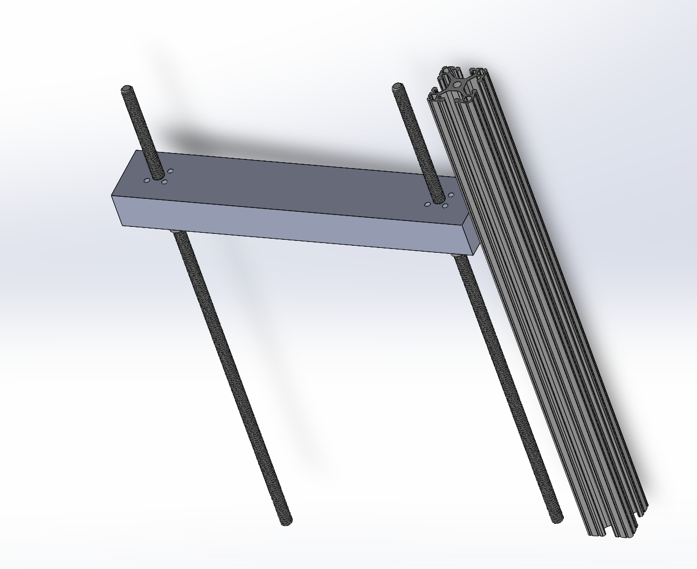

Now finally, the full assembly, including all parts of the body. I ended up trimming the frame of the original down to fit the length properly, though after doing so there was some slight overhang, though it should still function properly. But it includes everything that was accounted for in our calculations, and everything is depicted below.

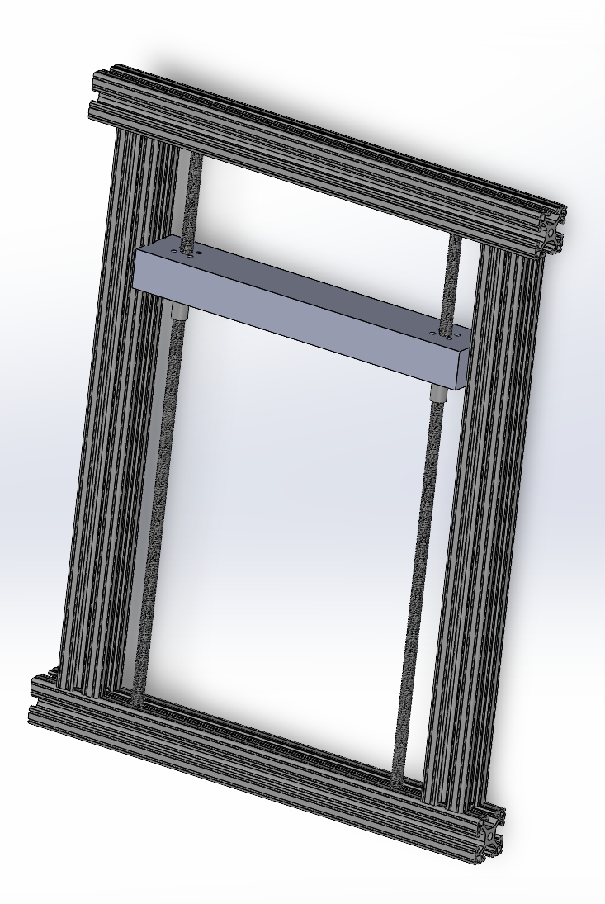

### Part 6: Lessons Learned - Carlos Aranda Perez

This assignment taught us all a few things. Firstly we had no idea what assumptions could be made if any for any of the parts. After the lead screw was picked, the other parts of the assignment had to be found using the correct dimensions from the lead screw. Being consistent in our own work and with each other not only proved our understanding of material but also improved team efficiency.
Another part that we all learned was how to communicate effectively between each other. At the beginning of the assignment, we split up the workload so that we each took on equal responsibility for this assignment. We had a mutual understanding of how important it was to get the work done ahead of time. At the same time, we held each other accountable for meeting deadlines as well as the quality of our work and its accuracy.
Towards the end while generating the assembly on SolidWorks, we learned how to contribute to something that one single person was working on. This seems simple but when three people are working together on one single thing, it gets difficult to communicate ideas.
This assignment took around 14 hours to complete.

Below you can find a link to all of our work and the zip file for our assembled tester. 

 Download [Here!](assembly&parts.zip)
