# A11 – Motor Selection

For this assignment, we are continuing with the work from last week which included the designing of a leadscrew tensile tester. This week we are in charge of selecting and adding the motor to the tester, designing a frame, and designing a floating bearing. In this assignment we also utilize FEA analysis to ensure our frame holds up. Towards the end we have provided a full bill of materials, labor cost and our entire process for the assignment. 

Our team is composed of Carlos Aranda Perez, Jason Swanchara, and Gavin Winningham. 

## Motor selection and Attachments - Carlos Aranda Perez

For this part of the assignment, I was tasked with selecting an appropriate motor using the torque and speed requirement from the last assignment which for us was the following values: Max Torque at 1.72 N*m= 15.2233 in*lb = 243.57 in*oz_f; and our range for our RPM’s were the following: 0.4711-25.7 rotations per minute.  Looking through the motor selection, I was able to use the NEMA 23 stepper motor ([found here](https://www.mcmaster.com/6627T631/ )) that closely resembled our values. The max holding torque in this motor is 262 in*oz_f which is more than enough for our measly 244 in*oz_f. The rest of the specs for this motor includes a max RPM of 3000 which again, is so much greater than our calculated values. The voltage for the motor was given at 24 V, and current at 7 amps. This holds for when you go with the parallel wiring of the motor, it is also worth noting that we get a better torque speed curve with the parallel wiring, allowing us to stay in a continuous operating zone.

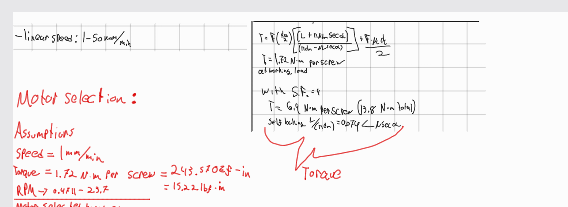

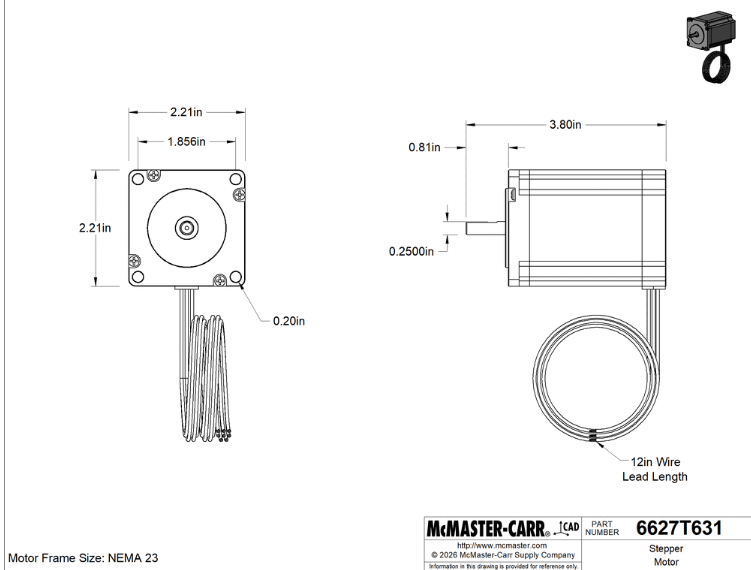

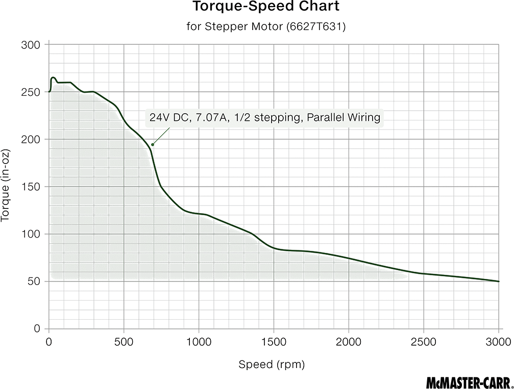

Now with the motor picked out, I had to design a bracket in which the motor could securely attach to the tensile tester. Starting off with the knowns and unknowns, then creating an FBD of the bracket. For the material we have been using 1018 carbon steel, using the following values MOE = 205 GPa= 29700 ksi, which were found [here](https://www.azom.com/article.aspx?ArticleID=6115 ). Taking the dimensions of the motor I decided it was best to give it some room to be able to position it properly, opting for a 4 by 4 bracket. 

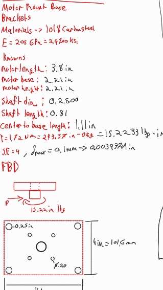

Using an equation for deflection provided by The Machinery’s Handbook, I was able to calculate the minimum thickness for the motor bracket. The minimum thickness came out to be 0.0415 in, which in my opinion was extremely small, so when my teammate modeled it in SolidWorks he changed it to be .3 inches as this worked better for the use in the frame.

Afterwards I began the design process for the coupler. Doing the same old same old process of listing the knowns and unknowns, drawing the FBD’s. We were tasked with finding the outer diameter and thickness of the coupler, to find them we had to use shear stress torsion analysis to find the inner and outer diameter of the coupler. 

Using the following equations, I solved for it algebraically then plugged and chugged. Doing so allowed me to find a thickness of 0.788.With that being said, I found that the outer diameter was 1.0795 inches, so I ended up choosing the Servomotor Precision Flexible Shaft Coupling. This coupler has ⅜” by ½” shaft diameter and an outer diameter of 1-1/16”. I chose this one because the outer diameter was extremely close to our calculated outer diameter and the inner diameter of ⅜” would nicely house our lead screws. The coupler used can be found [here](https://www.mcmaster.com/6854N105/).

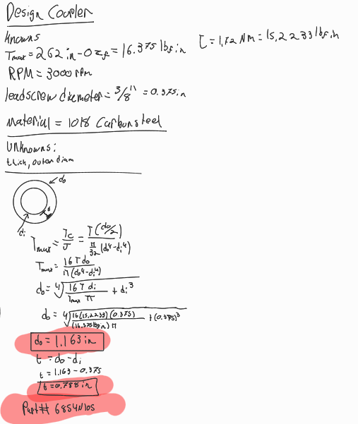

## Analyze and Design a Frame - Jason Swanchara

To find suitable connectors, I used 1018 steel again to keep consistency.  Using the Sy, T, the distance between the center of the center of the beam and bolts, and factor of safety, I found the minimum thickness required of the connectors to be very small.  This likely meant that the thickness would be governed by other factors.  I ended up choosing the 40-4481 5-hole L plate to connect the beam to the two columns.  This worked out because it matched one of the examples given in the appendix of the assignment and matched our dimensions of the frame.  The thickness of the plates is around 6 mm, which is significantly more than we need, but it wasn’t very realistic to find plates that were as thin as I had calculated in my stress analysis.

## Top frame verification FEA - Gavin Winningham

I first started by creating an assembly utilizing the frame of choice as well as the design motor mount, utilizing previous calculations by my partners. I then assembled the structure depicted below and conducted a simulation, fixing the ends of the assembly and the motor mounts and applying our 2,000 newton force at the motor mount.

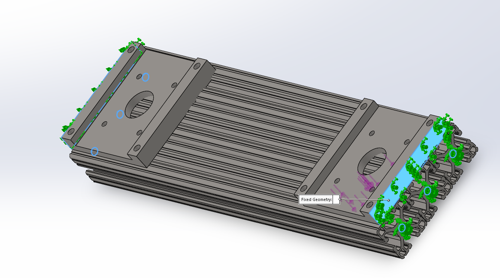
I first started off with a coarse mesh for this analysis. After doing so, with the Von Mises stress analysis, got a peak stress of 8.757 times 10 to the seventh newtons per meter squared. After looking at the actual deflection itself and the stress concentrations, there didn't seem to be nearly as much, except for at the individual corners of the motor mounts. Moving on to the deflection, there was a significant deflection near the center of the assembly, specifically within the frame itself, with a max deflection of 1.57 times 10 to the 2 millimeters. Then utilizing the factor of safety, for this specific part, I ended up getting from the simulation a factor of safety of 4.015.

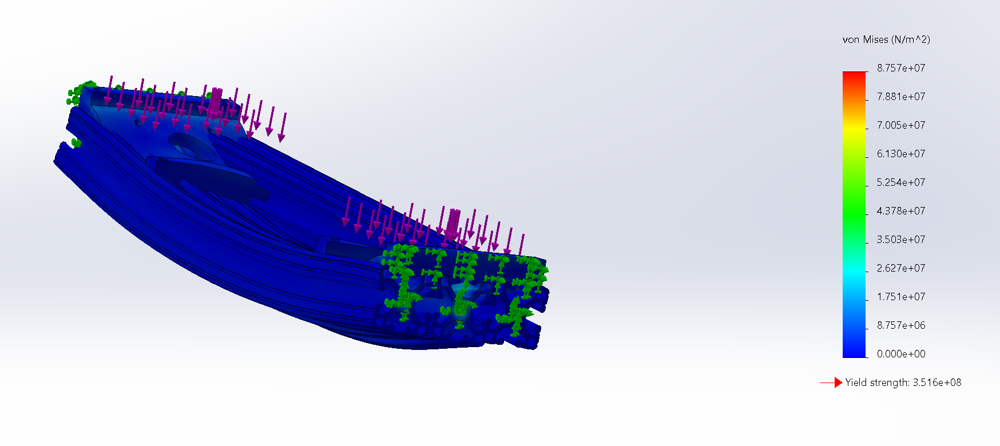
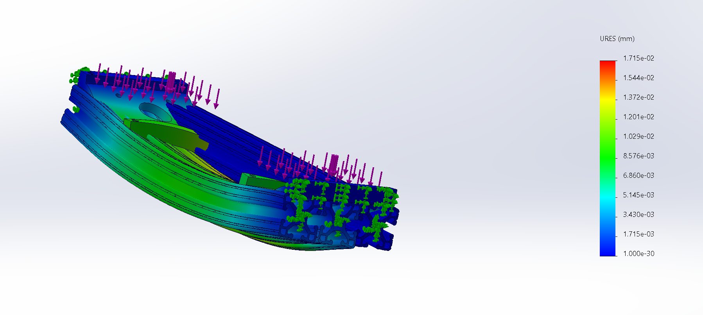
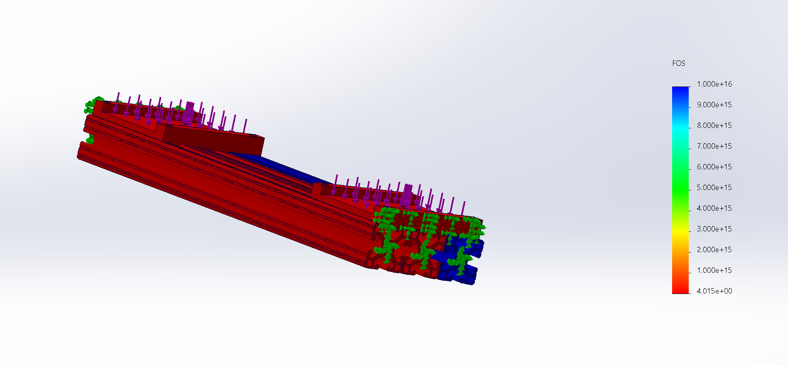
Next, I then moved on to the medium mesh for this design, starting off with the von Mises stress. I ended up getting a peak stress concentration of 7.777 times 10 to the seventh newtons per meter squared, specifically at the same concentrations of corners within the actual assembly itself. Next was the peak deflection that this part experienced, noting similar deflection areas, specifically within the center, with a max deflection of 1.661 times 10 to the second millimeters. Moving on to the factor of safety experienced by the simulation, it ended up getting a value of 4.521.

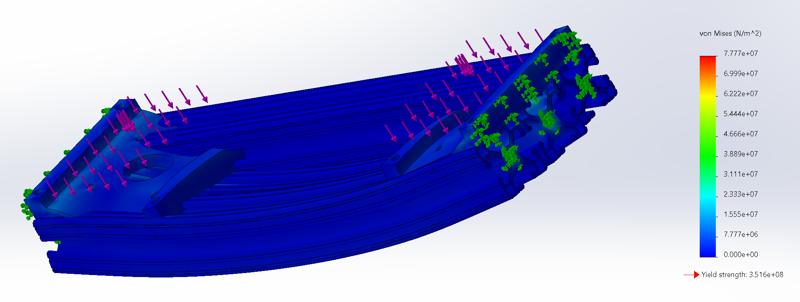
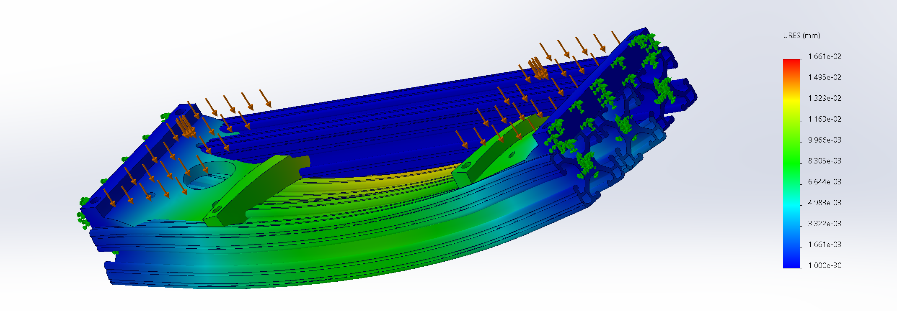
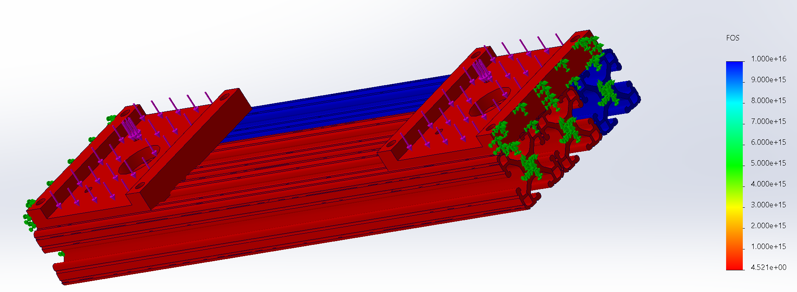
Going further with the analysis of this assembly, my computer unfortunately had some issues in regards to going to the finest mesh quality. There were too many items for my computer to handle and I tried multiple ways of seeing how I could manipulate it to account for this. Unfortunately, I was not able to go to the finest mesh quality for this assignment.
### Optimization Pass
After fully doing this analysis on the assembly, noting the stress concentrations as well as the significant deflection in the center, the main optimizations that could be done to improve this design is adding chamfers and anything to assist with the stress concentrations at the different edges of the object itself, as well as utilizing thicker frames to account for the significant deflection at the center of the simulation. Adding more material would reduce the deflection experienced and would optimize it.

## Vertical component verification FEA - Gavin Winningham

Next was the verification of the vertical components of the frame and assembly. I first started with creating the actual assembly specific to the vertical components and fixing the bottom end, utilizing the FEA and adding the 2,000 newton force on the top load of this vertical component. Next I went into the actual mesh. I first started off with a coarse mesh and ran the simulation. After doing so, the von Mises stress diagram concluded a stress concentration maximum of 3.063 times 10 to the seventh newtons per meter squared. After inspecting the image itself, I noted the stress concentrations were similarly at different corners of the actual object itself. Next, I then looked at the displacement experienced by the vertical component, noting the maximum deflection to be 1.654 times 10 to the 2 millimeters, noting that surprisingly the main deflection was happening at the top of the vertical component. I was initially coming to the assumption that the main deflection would be happening at the center of this vertical component due to its inertia and geometrical components allowing for more movement within that area. Next was the factor of safety. After running the simulation, the factor of safety was concluded to be 1.148 times 10 to the 1.

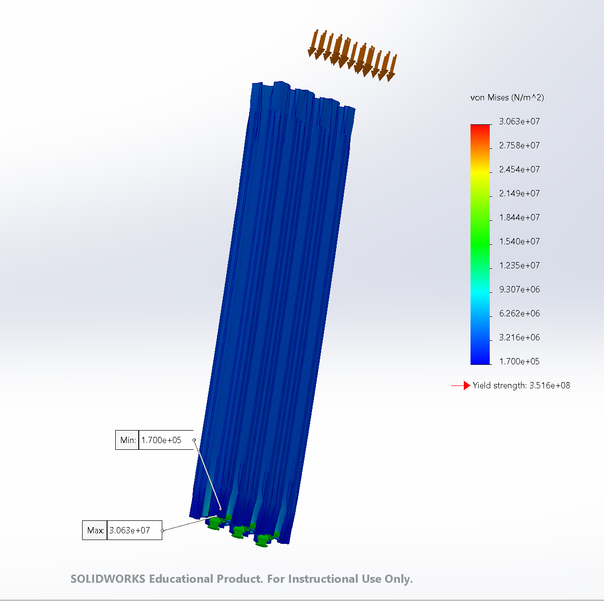
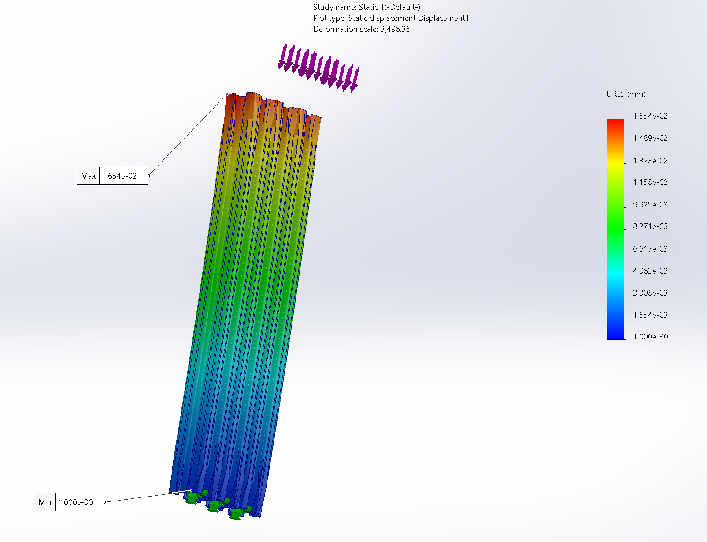
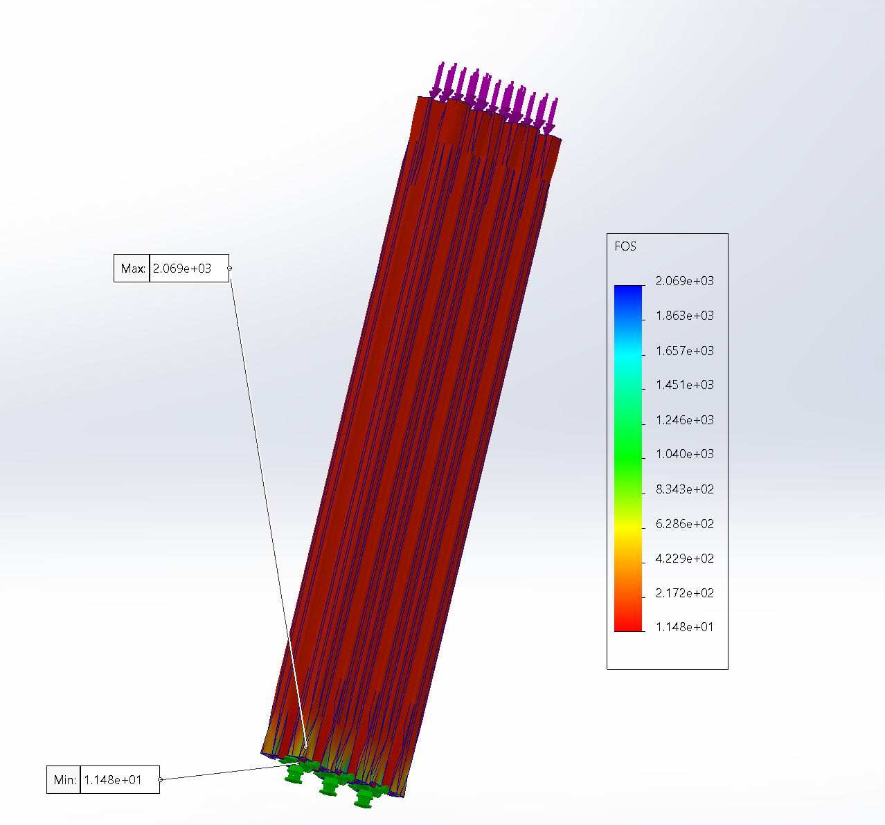

After running this simulation on a coarse mesh, I then tried to go to a medium and fine mesh, though it had significant issues regarding number of meshes within the actual simulation, and had errors running the meshes as well as the actual simulation itself. Due to this, I unfortunately only was able to run the simulation on coarse as depicted above.

### Optimization Pass

After concluding the simulation on the vertical components of this assembly, I noted the stress concentrations at the different corners on the assembly, as well as the main deflection near the top of the object. After taking into account these two factors and concerns in the design, being able to help eliminate them would be adding chamfers to the actual object itself, as well as thickening the overall material of the support to allow for less deflection, specifically within the top and center edges.

## Floating Bearing Mount - Jason Swanchara

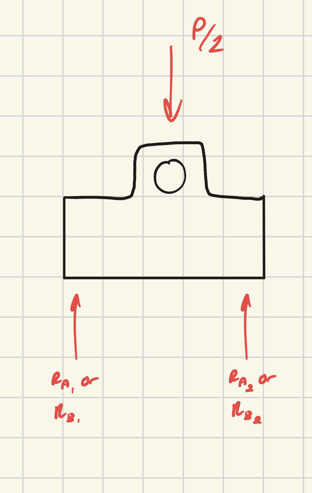

The floating bearing mount is vital to centering the leadscrew while still enabling slight vertical motion when necessary.  Only the top is fixed and carries the load, 1 KN per screw.  The assignment requires an RC3 fit, which allows for free spinning of the screws and very little wobbling.  Assuming a quarter inch bolt, using Table 8a in the Machinery’s Handbook, clearance would be between 0.5 - 1.5 thousandths of an inch.  This small gap ensures that the journal doesn’t bind and can spin freely.  The mount would be 40 mm wide because it would need to match the rail.  For the height, I said 20 mm because that would guarantee the bush would be fully supported since it was less than that.  Finally, the length would be 80 mm so that both bolts and the bushing are able to fit in that length.  

## Bill of Materials - Jason Swanchara

| Item Number | Quantity | Name | Cost per Item | Cost | Purchase Link |
|---|---:|---|---:|---:|---|
| 47065T102 | 4 | T-Slotted Frame | $18.76 | $75.04 | [Purchase Here](https://www.mcmaster.com/47065T102/) |
| 95120A592 | 2 | Flange Nut | $111.78 | $223.56 | [Purchase Here](https://www.mcmaster.com/95120A592/) |
| 99030A992 | 2 | Lead Screw | $17.04 | $34.08 | [Purchase Here](https://www.mcmaster.com/99030A992/) |
| 6627T631 | 2 | Motor | $100.92 | $201.84 | [Purchase Here](https://www.mcmaster.com/6627T631/) |
| 6854N105 | 2 | Coupler | $191.33 | $382.66 | [Purchase Here](https://www.mcmaster.com/6854N105/) |
| 40-4481 | 4 | T-Slot Connector | $15.89 | $63.56 | [Purchase Here](https://www.grainger.com/product/80-20-T-Slot-Framing-System-Connecto-906TA2?searchQuery=40-4481&searchBar=true&tier=Tier+6&s_e=false&s_c=solr9) |
| **Total** | **16** | | | **$980.74** | |

| Person | Hours Worked | Cost/Hour | Cost |
|---|---:|---:|---:|
| [Carlos Aranda Perez] | [12] | $35.00 | $[420] |
| [Jason Swanchara] | [12] | $35.00 | $[420] |
| [Gavin Winningham] | [14] | $35.00 | $[490] |
| | | **Total Cost** | **$[1,330]** |

**Total Cost of Project:** = $980.74 + 1,330=**2,310.74**

## Lessons Learned - Carlos Aranda Perez

This assignment really pushed the team’s limits. We learned how to apply the lessons taught in last week’s lecture in real life. We also learned that time management is critical to completing these assignments on time. We learned how to apply bearing stress to the bracket that supports the motor, it took hours to get right. We also learned how to optimize an assembly in solidworks, and how to troubleshoot issues on the fly. One of our laptops wasn't happy with the assembly being created. Finally, the last thing we learned was to make sure to double check dimensions before adding materials to the list, because it just wastes time having to look back through the database for the correct size for the assembly.

Overall this assignment took us over 13+  hours to complete.
